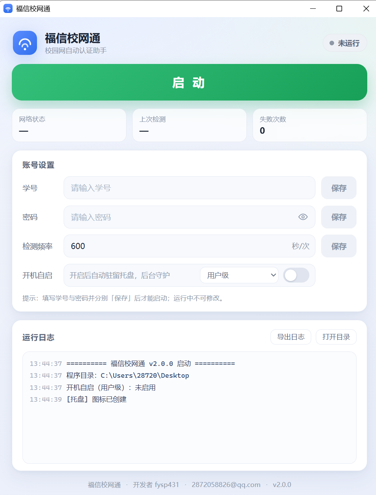

# 福信校网通 · FJPIT 校园网自动认证助手

> 断网自动重连，告别手动点「登录」。一个常驻托盘的小工具，专为 **福建信息职业技术学院平潭校区（FJPIT）** 校园网 ePortal 认证打造。

<p>  
    
    
    
    
</p>

<p align="center">
  <a href="docs/screenshot.png"></a>
</p>

---

[这是什么](#这是什么) · [功能特性](#功能特性) · [下载与安装](#下载与安装) · [快速上手](#快速上手) · [使用说明](#使用说明) · [工作原理](#工作原理) · [常见问题](#常见问题) · [技术栈](#技术栈) · [目录结构](#目录结构) · [本地开发](#本地开发) · [打包](#打包) · [运行期文件](#运行期文件) · [免责声明](#免责声明) · [许可证](#许可证) · [作者](#作者)

---

## 这是什么

连上校园 WiFi 后，认证过期往往不会有任何提示——浏览器打不开、游戏掉线，得手动打开网关页面重新登录。  
这个小工具会在后台按你设定的频率探测网络，一旦发现"连着 WiFi 但没认证"，就自动完成 ePortal 网页认证，  
网络恢复后继续静默守护。

界面用 **Python + pywebview** 重写（原生 WebView2 渲染），托盘常驻，仅 ~21 MB 单文件、免安装。

## 功能特性

**自动认证**

- 三源连通性探测（gstatic `generate_204` / msftconnecttest / captive.apple，Apple 页按 200+Success 校验），避免被劫持页骗过
- **显式绕过系统代理**：断网时若系统代理仍可达探测域名，会被误判为"在线"——这里用直连彻底规避
- 自动跟随门户跳转链（302 链 + 200 页面的 JS/meta 跳转，最多 6 跳），提取 `index.jsp?…` 认证参数
- 密码按网关要求做 **RSA PKCS#1 v1.5** 加密（十进制串回传）；公钥缺失或密码超长时直接报错，不再回退明文
- 会话残留处理：落到 `redirectortosuccess` 且无参数时，用空参数强制刷新认证会话
- 认证提交后每 5 秒复检、最长等 60 秒，确认真的通了才算成功

**守护与重试**

- 失败间隔 30 秒重试，连续 3 次自动停止并复位界面
- 账号/密码错误（"用户不存在""密码不匹配"）**立即停止**，不无意义重试，直接显示网关原文；网关公钥异常等不可恢复错误同样立即停止
- 状态变化记事件日志；每次检测另记一行运行数据（各探测源耗时/结果、认证步骤耗时），便于事后排查
- 三源探测并发执行，最坏耗时约 5 秒，不会被串行 3×5 秒拖过 10 秒的最小检测间隔
- 认证失败自动落盘诊断文件（pageInfo / login 原始响应 + 跳转链，脱敏、单份 ≤ 256 KB），主日志只记路径摘要
- 日志超过 2 MB 自动轮转，保留 3 份历史（`.1`~`.3`）；导出时拼接轮转历史，保留完整日期
- 检测频率最低 **10 秒/次**；需在停止状态下修改，下次启动生效

**自动运行与关机记录**

- **记住上次运行状态**：启动时若上次退出前监控正在运行（且已保存账号密码），自动开始检测；手动点「停止」后下次不再自动运行
- **等待网络就绪**：开机/启动时先等门户可达，最多 **180 秒**、每 5 秒重试；等待期间**不计入失败次数**，超时也照常进入检测循环
- **关闭原因分类**：托盘「退出」、系统关机/注销（明确记录为非用户操作）、异常关闭（下次启动回查运行标记并补记）
- 关机时只记录原因并放行，**不隐藏窗口、不阻塞系统关机**

**界面**

- 卡片式现代 UI：状态徽标、在线/离线、上次检测、失败计数一屏可见
- 三个指标方框占左半宽，启停按钮占右半宽，点按区域更大；日志区高度做了压缩
- 自启说明右侧有圈形感叹号，悬停可查看自动运行 / 等待网络 / 关机行为的说明
- 运行中与停止收尾期间锁定账号、密码与频率，防止误改
- 保存按钮两态（有改动才可点）、密码显隐
- 学号/密码输入即时过滤中文、空格与不可见字符；保存失败时提示可读原因并回滚本次修改
- 配置文件损坏时顶部显示可关闭的黄色提示条，不再静默按默认值启动
- 日志实时滚动，支持导出与打开所在目录

**托盘与自启**

- 点 × 隐藏到托盘继续跑；左键恢复窗口；右键「打开主界面 / 退出」
- 托盘提示实时显示「运行中 / 已停止」
- 开机自启（用户级，写入 `HKCU\…\Run`，免管理员），带 `--min` 静默驻留托盘；若上次监控在运行，启动后自动开始检测
- 自启作用域下拉预留「系统级（开发中）」接口

**安全**

- 学号密码用 `AES-GCM` 加密后存本地（`SHA256("fuxin-xiaowangtong|" + salt)` 派生密钥），不联网上传
- 日志自动脱敏：`mac` / `wlanuserip` / `nasportid` 等网络标识只保留前 4 位（含 URL 编码与 JSON 形式）；password / pwd / token / ticket 字段整体打码
- 学号/密码只接受 ASCII 可打印字符（0x21-0x7E），前端过滤 + 后端白名单双重校验，防绕过
- 程序目录不可写时自动回退到 `%LOCALAPPDATA%\FuxinNet`，并迁移旧配置，不再静默丢设置
- 单实例：重复双击只会把已有窗口叫出来

## 下载与安装

1. 到 [Releases](https://github.com/fysp431/FuxinNet/releases/latest) 下载 `FuxinNet_v2.0.0.exe`（或自行编译，见下文）
2. **建议放到独立文件夹**，不要直接在压缩包里双击运行
3. 双击启动。首次运行可能出现「Windows 已保护你的电脑」→ 点「更多信息」→「仍要运行」  
   （程序没有购买代码签名证书，属正常现象）
4. 需要 **WebView2 运行时**：Win11 与较新的 Win10 自带 Edge 即可；若提示无法初始化界面内核，  
   安装 [Microsoft Edge WebView2 Runtime](https://developer.microsoft.com/microsoft-edge/webview2/) 后重试

> 首次运行会在程序目录生成 `fuxin_log.txt`、`fuxin_config.dat`、`fuxin_running.marker`、`webview_data\`，属正常产物；该目录不可写时会自动改到 `%LOCALAPPDATA%\FuxinNet\`。

## 快速上手

1. 填「学号」→ 点右侧 **保存**
2. 填「密码」→ 点 **保存**（保存后输入框提示"已保存，留空则不修改"）
3. 点顶部绿色 **启 动**

运行后按钮变红「停 止」，账号信息锁定。要改设置先点停止；若此时正在认证，界面会显示「正在停止」，后台收尾完成后自动恢复可编辑状态。  
若启动时校园网尚未就绪，状态会显示「等待网络」，最多等待约 180 秒，期间不计失败次数。

**断网验证**：连上校园网但处于"需要登录"状态 → 点启动 → 日志应依次出现  
`检测到断网（第N次检测），开始认证` → `已获取认证跳转URL: …` → `[认证] 认证成功，网络已恢复 用时=…ms`。

## 使用说明

| 项    | 说明                                    |
| ---- | ------------------------------------- |
| 检测频率 | 单位 **秒/次**，最小 **10**（默认 600）、必须整数、**不设上限**；停止状态下修改，下次启动生效；旧配置中低于 10 的值会自动按 10 读取 |
| 自动运行 | 启动时若上次退出前监控在运行且已保存账号密码，自动开始检测；手动点「停止」后下次启动保持停止 |
| 等待网络 | 开机/启动时门户不可达会先等待，最长 **180 秒**（每 5 秒重试），不计入失败次数 |
| 开机自启 | 作用域选「用户级」后打开开关；选「系统级（开发中）」时开关置灰       |
| 关闭窗口 | 隐藏到托盘，后台继续运行                          |
| 真正退出 | 托盘右键 →「退出」（会先停止检测并写日志）                |
| 关机/注销 | 记录「系统关机或注销，非用户操作」后放行，不阻塞系统关机；若进程被强杀，下次启动补记异常关闭 |
| 日志   | 程序目录（不可写时回退 `%LOCALAPPDATA%\FuxinNet`）的 `fuxin_log.txt`，也可在界面「导出日志」 |

## 工作原理

```
等待门户可达（开机最多 180 秒，不计失败；超时照常继续）
    ↓
探测在线？ ──是──> 安静等待下一轮
    │
    否
    ↓
跟随跳转链（≤6 跳）拿到 index.jsp?wlanuserip=…&mac=…    ← 参数原样回传，不解码再编码
    ↓
GET  /eportal/InterFace.do?method=pageInfo&indexParams=…  ← 取 passwordEncrypt / 公钥
    ↓
RSA PKCS#1 v1.5 填充 + 裸模幂 → 十进制字符串                ← 网关要求时才加密
    ↓
POST /eportal/InterFace.do?method=login
     userId / password / service="" / passwordEncrypt / queryString
    ↓
解析 {"result":"success"} 或 {"result":"fail","message":"…"}（含 \uXXXX 解码）
    ↓
每 5 秒复检，最多 60 秒；成功即恢复守护
```

失败分类处理：**凭据错误**与**网关公钥异常**立即停止；**网络类失败** 30 秒后重试，连续 3 次停止。

## 常见问题

<details>

<summary><b>双击没反应 / 白屏</b></summary>

多半被杀毒软件拦截，或 SmartScreen 提示没点「仍要运行」。  
白屏通常是 WebView2 未能渲染页面：把 exe 放到不含特殊字符的普通目录（`D:\某个新文件夹`）再试，  
并把 `fuxin_log.txt` 一并反馈。

</details>

<details>

<summary><b>点了 × 程序是不是退出了？</b></summary>

没有，隐藏到托盘了（可能被折叠进任务栏「^」溢出区）。左键点托盘图标即可恢复。

</details>

<details>

<summary><b>开机自启没生效</b></summary>

① 确认作用域是「用户级」且开关是绿色；② 任务管理器 →「启动」看「福信校网通」是否被禁用；  
③ 换过 exe 位置的话，把开关关一次再开一次，让注册表值指向新路径。

</details>

<details>

<summary><b>开机自启后没有自动开始检测</b></summary>

自动运行取决于「上次退出时的状态」：手动点过「停止」后，程序会记住不再自动运行；  
另外需要先保存学号和密码。确认后重新点一次「启动」即可恢复下次自动运行。

</details>

<details>

<summary><b>日志为什么写「系统关机或注销，非用户操作」？</b></summary>

程序通过 WinForms 的 `CloseReason` 区分关闭原因：系统关机/注销会写这一条并直接放行，不隐藏窗口、不阻塞关机；  
托盘「退出」写「用户手动退出」；任务管理器强杀无法在死亡瞬间写日志，会在下次启动时补记「疑似异常关闭」。

</details>

<details>

<summary><b>提示"已在运行中"</b></summary>

托盘里已有一个实例，它会自动把窗口叫出来——不需要也不允许再开第二个。

</details>

<details>

<summary><b>放在 Program Files 里，设置和日志去哪了？</b></summary>

程序目录不可写时，运行期文件会自动切换到 `%LOCALAPPDATA%\FuxinNet\`，并把旧位置的
`fuxin_config.dat` 复制过去；启动日志第一行会写明本次使用的数据目录。

</details>

<details>

<summary><b>认证失败时多出来的 fuxin_dump_*.txt 是什么？</b></summary>

是一次认证失败的诊断现场：pageInfo / login 的原始响应和跳转链 URL，已经脱敏
（mac、wlanuserip、password、token 等打码），单份不超过 256 KB，只在失败时生成。
反馈问题时可以连同 `fuxin_log.txt` 一起提供。

</details>

<details>

<summary><b>认证一直失败怎么排查</b></summary>

看日志最后几行：

| 日志                      | 含义              | 处理             |
| ----------------------- | --------------- | -------------- |
| `用户不存在` / `密码不匹配`       | 凭据错误，程序已自动停止    | 核对学号密码         |
| `密码加密失败` / `未返回公钥`        | 网关公钥异常，不可恢复，已自动停止 | 稍后重试；持续出现请反馈日志 |
| `无法连接认证服务器`             | 不在校园网 / 未连 WiFi | 检查网络           |
| `认证已提交，但等待 60 秒后网络仍未连通` | 网关收下了但没放行       | 重试一次，或手动开浏览器对比 |
| `认证服务器可达但未获取到认证参数`      | 可能网络已经恢复        | 通常可忽略          |

</details>

## 技术栈

| 层  | 选型                                         |
| -- | ------------------------------------------ |
| UI | HTML + CSS + 原生 JS（WebView2 渲染）            |
| 壳  | pywebview 6 + WinForms                     |
| 后端 | Python 3.11（`http.client` 直连，无第三方 HTTP 依赖） |
| 加密 | cryptography（AES-GCM）                      |
| 托盘 | pystray + Pillow                           |
| 打包 | PyInstaller（单文件）                           |
| 关闭判定 | WinForms `FormClosing` + `CloseReason`（区分系统关机 / 点 X / 主动退出） |

## 目录结构

```
.
├─ run.py                 # 入口（写 .NET app.config → 起界面）
├─ fuxin.spec             # 单文件打包
├─ fuxin_portable.spec    # 免解压目录版打包
├─ requirements.txt       # 运行期依赖
├─ requirements-dev.txt   # 构建 / 测试期依赖
├─ pyproject.toml         # ruff / pytest 配置
├─ assets/                # 图标
├─ docs/                  # 截图
├─ ui/                    # 前端：index.html / style.css / app.js
├─ src/fuxin/
│  ├─ main.py             # DPI、单实例、托盘、关闭策略、窗口
│  ├─ paths.py            # 路径与常量（数据目录探测 / 回退 / 迁移）
│  ├─ logger.py           # 日志：文件 + 内存 + 脱敏 + 导出
│  ├─ config.py           # 配置：AES-GCM 读写
│  ├─ diagnostics.py      # 认证失败诊断落盘（脱敏、限 256 KB）
│  ├─ net.py              # 直连 HTTP、并发探测、跳转链
│  ├─ auth.py             # pageInfo / RSA / login / 完整认证
│  ├─ worker.py           # 监控线程与重试状态机
│  ├─ tray.py             # 系统托盘
│  ├─ autostart.py        # 开机自启（用户级 / 系统级预留）
│  └─ api.py              # 前端桥（轮询 + 保存 + 启停 + 日志）
└─ tests/                 # pytest 用例（脱敏 / URL / RSA / 线程 / api / 路径回退）
```

## 本地开发

> **必须用 Python 3.11**：pythonnet 3.2+ 只提供 netstandard2.1 程序集，.NET Framework 4.8 加载不了；  
> 只有 3.11 + pythonnet 3.0.5 才能走系统自带 .NET Framework，打包后的 exe 也才能"开箱即用"。  
> 3.12 / 3.13 下的兼容性**没有验证过**，不要用它们打包或跑测试。

```bat
python -m venv .venv
.venv\Scripts\pip install -r requirements-dev.txt
.venv\Scripts\python run.py
```

运行测试与静态检查（不需要校园网；认证流程用本地 mock ePortal）：

```bat
.venv\Scripts\python -m pytest
.venv\Scripts\python -m ruff check .
```

`tests/` 覆盖脱敏、URL 解析、RSA、完整认证流程、配置、线程生命周期、
api 保存/校验、数据目录回退与迁移；CI（`.github/workflows/ci.yml`）在
Python 3.11 上跑同样的两条命令。

## 打包

```bat
python -m PyInstaller --noconfirm --clean fuxin.spec
```

产物：`dist\FuxinNet_v2.0.1-alpha2.exe`（单文件）。

产物名中的版本号由 `src/fuxin/paths.py` 的 `APP_VERSION` 自动生成，发版时只改该常量即可，无需再动 spec。


已经在 spec/代码里处理掉的四个坑（改配置时别删）：

| 现象                                                   | 原因                                 | 处理                                                        |
| ---------------------------------------------------- | ---------------------------------- | --------------------------------------------------------- |
| `Could not create temporary directory!`              | `runtime_tmpdir` 用了相对路径 `.`，解析的是进程当前工作目录；开机自启时 CWD 为 `C:\Windows`，普通用户不可写 | spec 里改为 `runtime_tmpdir=r"%LOCALAPPDATA%\FuxinNet\tmp"`，固定为用户可写绝对路径，与 CWD 无关 |
| `Failed to resolve Python.Runtime.Loader.Initialize` | .NET Framework 把路径判为"远程程序集"        | `run.py` 导入前自动写 `<exe>.config`，打开 `loadFromRemoteSources` |
| 窗口白屏                                                 | 中文路径 / `file://` 在 WebView2 偶发加载失败 | UI 改由本地回环服务加载（`http_server=True`），`storage_path` 固定数据目录   |
| 关机被阻塞 / 日志误记为后台运行                                   | pywebview closing 在关机时返回 False 会否决关机 | 改用 WinForms FormClosing + CloseReason 单一决策，关机分支不隐藏窗口 |

## 运行期文件

默认都在程序（exe）同目录。若该目录不可写（如 `C:\Program Files`、只读介质），
程序启动时会自动回退到 `%LOCALAPPDATA%\FuxinNet\`，并把旧位置的
`fuxin_config.dat` 复制过去；选定的目录会写进日志开头，方便排障。

| 文件                       | 说明                              |
| ------------------------ | ------------------------------- |
| `fuxin_config.dat`       | 学号/密码（AES-GCM 密文）+ 检测频率 + 自启作用域 + `auto_run`（上次退出时监控是否在运行） |
| `fuxin_running.marker`   | 运行标记，用于识别上次是否异常关闭；正常退出时自动删除 |
| `fuxin_log.txt`          | 运行日志（UTF-8 / CRLF / `[时间] 内容`），超 2 MB 自动轮转为 `.1`~`.3` |
| `fuxin_dump_*.txt`       | 认证失败诊断现场（pageInfo / login 原始响应 + 跳转链，已脱敏，单份 ≤ 256 KB；仅在失败时生成） |
| `fuxin_log_export_*.txt` | 「导出日志」的副本，包含 `.1`~`.3` 轮转历史与完整日期时间戳 |
| `webview_data\`          | WebView2 缓存，可删                  |

## 免责声明

- 本项目为个人学习与自用工具，与学校、网络中心无任何从属关系
- 仅在你**本人已获得授权**的账号与网络环境下使用；请遵守学校网络使用规定
- 凭据只保存在本机（加密），不会上传；但因使用本工具产生的任何后果由使用者自行承担

## 许可证

MIT

## 作者

**fysp431** · 邮箱 <2872058826@qq.com>

如果这个小工具帮到了你，点个 ⭐ 就好。
